# Геокабинет — аналитика присутствия на геосервисах

[](https://github.com/ermahavwork/geo-analytics-cabinet/actions/workflows/ci.yml)

Кабинет для компаний с несколькими филиалами: сколько раз открывали карточки на картах, сколько было переходов на сайт, звонков и построенных маршрутов, какой рейтинг и что пишут в отзывах. Администратор видит все компании, клиент — только свою.

Тестовое задание: минимальная рабочая версия аналитического кабинета. Стек — Next.js 16 и React 19, NestJS 12, PostgreSQL 18, TypeScript, Docker.

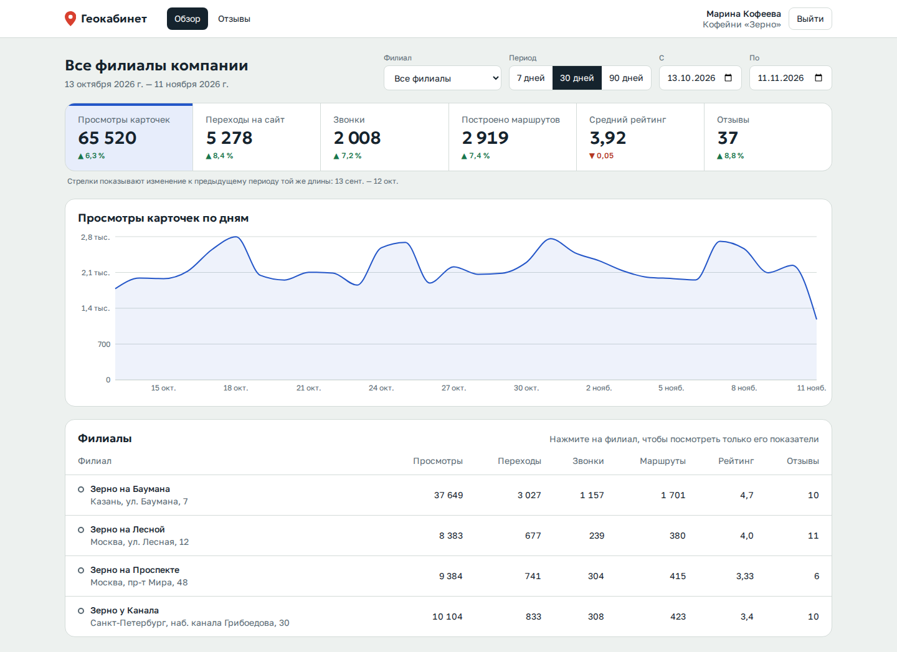

## Запуск

Нужен только Docker (Docker Desktop на Windows и macOS, Docker Engine с Compose на Linux).

```bash
git clone https://github.com/ermahavwork/geo-analytics-cabinet.git
cd geo-analytics-cabinet
docker compose up --build
```

Первая сборка занимает 2–4 минуты. Когда в логе появится `web-1 | ✓ Ready`, откройте <http://localhost:3000>.

Настраивать ничего не нужно: миграции, роли базы и демо-данные создаются сами при первом запуске. Данные вымышленные.

| Роль | Почта | Пароль | Что видит |
|---|---|---|---|
| Администратор | `admin@demo.local` | `Admin-demo-2026` | все три компании, девять филиалов, синхронизацию |
| Клиент | `zerno@demo.local` | `Client-demo-2026` | кофейни «Зерно», 4 филиала |
| Клиент | `ulybka@demo.local` | `Client-demo-2026` | стоматология «Улыбка», 3 филиала |
| Клиент | `garage@demo.local` | `Client-demo-2026` | автосервис «Гараж 24», 2 филиала |

На странице входа эти доступы подставляются одним нажатием.

<details>
<summary>Порт 3000 или 4000 занят, нужно начать с чистой базы, остановить проект</summary>

Порты меняются без правки файлов:

```bash
WEB_PORT=8080 API_PORT=8081 docker compose up --build
```

В PowerShell:

```powershell
$env:WEB_PORT=8080; $env:API_PORT=8081; docker compose up --build
```

То же можно записать в файл `.env` (образец — `.env.example`).

Остановить: `Ctrl+C`, затем `docker compose down`. Удалить и базу: `docker compose down -v` — при следующем запуске демо-данные создадутся заново.

Порт PostgreSQL наружу не открывается, поэтому с базой на вашей машине проект не конфликтует.

</details>

<details>
<summary>Что открыть помимо интерфейса</summary>

- <http://localhost:4000/api/docs> — описание REST API (OpenAPI), собирается из тех же схем, которыми проверяются запросы. Порт API открыт только на localhost.
- <http://localhost:4000/api/health> — проверка, что API видит базу.

Прямой запрос к API из терминала:

```bash
TOKEN=$(curl -s -X POST http://localhost:4000/api/auth/login \
  -H 'content-type: application/json' \
  -d '{"email":"zerno@demo.local","password":"Client-demo-2026"}' | sed 's/.*"accessToken":"\([^"]*\)".*/\1/')

curl -s "http://localhost:4000/api/analytics/summary?from=2026-10-01&to=2026-10-31" \
  -H "Authorization: Bearer $TOKEN"
```

</details>

## Что сделано по заданию

| Пункт задания | Где смотреть |
|---|---|
| Вход, роли администратора и клиента | Страница входа; `apps/api/src/auth` |
| Чужие данные недоступны ни через интерфейс, ни прямым запросом | Два слоя защиты, см. «Изоляция данных»; тесты `apps/api/test/isolation.e2e-spec.ts` |
| Шесть показателей | Полоса показателей на странице «Обзор» |
| Фильтр по филиалу и периоду | Панель над показателями: филиал, 7/30/90 дней или свои даты |
| График динамики | Под показателями; нажатие на показатель переключает график на него |
| Список филиалов, выбор филиала, статистика по нему, сводка по всем | Таблица «Филиалы» на «Обзоре»: строка выбирает филиал, без выбора показана сумма по всем доступным |
| REST API и структура PostgreSQL | `apps/api/src`, схема — `apps/api/src/db/migrations` |
| Миграции и тестовые данные | Применяются при запуске; 3 компании, 9 филиалов, 4 пользователя, 180 дней статистики, около 350 отзывов |
| Доп. задание А: отзывы с фильтрами по рейтингу и статусу | Раздел «Отзывы», статус обработки меняется на месте |
| Доп. задание Б: имитация внешнего API, сохранение, повторные запросы | Раздел «Синхронизация» (администратор), см. «Синхронизация с внешним API» |
| Реальные запросы фронтенда к бэкенду, данные в базе | Весь интерфейс работает через REST API, моков во фронтенде нет |
| Серверная проверка прав | Проверка в API на каждом запросе плюс Row-Level Security в PostgreSQL |
| Ошибки и состояния загрузки | Заглушки на время загрузки, сообщения с кнопкой повтора, пустые состояния, истёкшая сессия |
| Не меньше двух автотестов, один — на изоляцию компаний | 85 тестов API на настоящем PostgreSQL и 13 сценариев в браузере |

Выполнены оба варианта дополнительного задания.

## Скриншоты

<details>
<summary>Вход</summary>

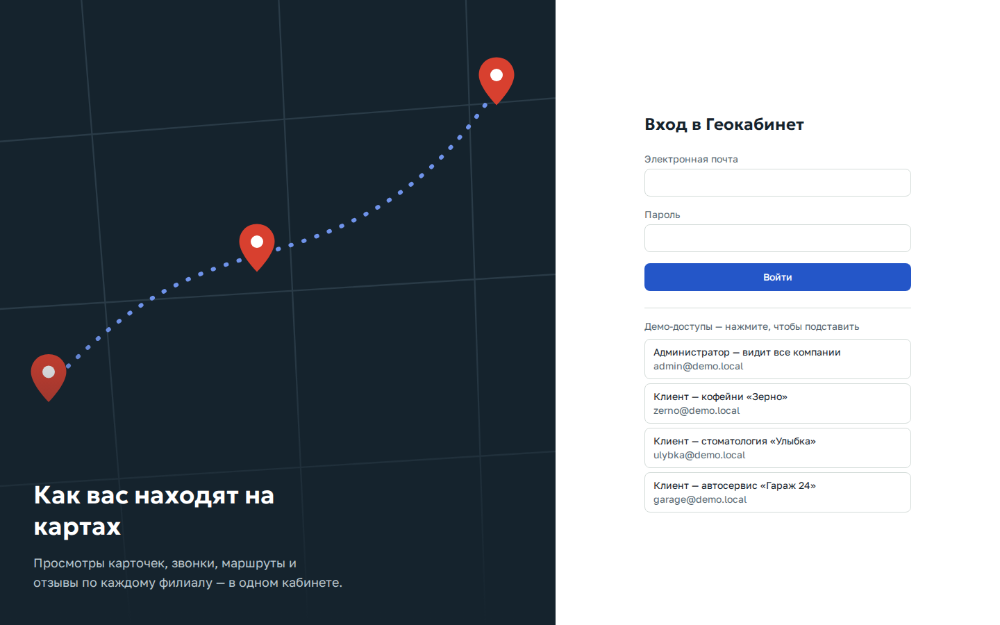

</details>

<details>
<summary>Обзор клиента: выбран филиал, показатель «Звонки», период 7 дней</summary>

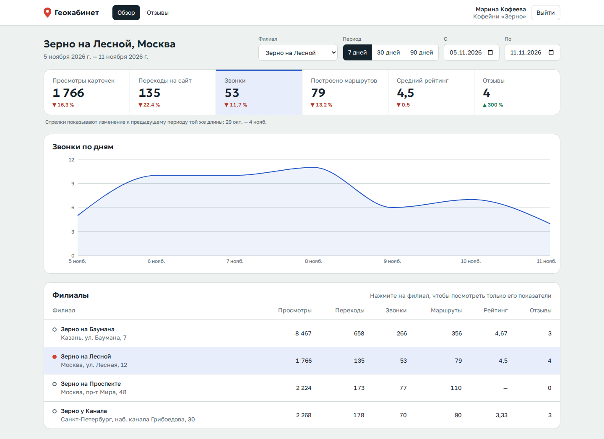

</details>

<details>
<summary>Обзор администратора: все компании</summary>

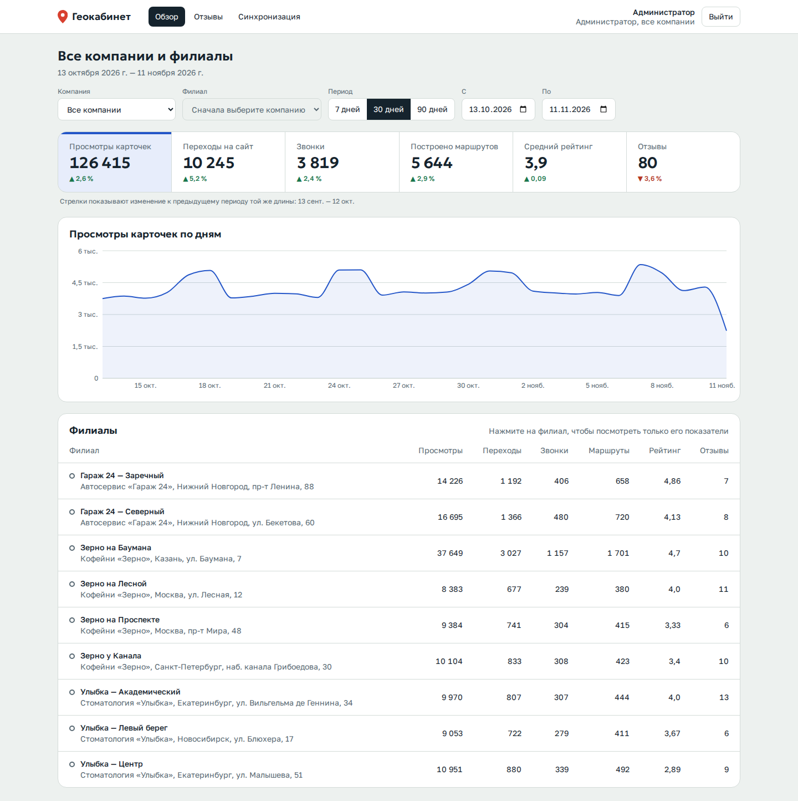

</details>

<details>
<summary>Отзывы и фильтры по оценке и статусу</summary>

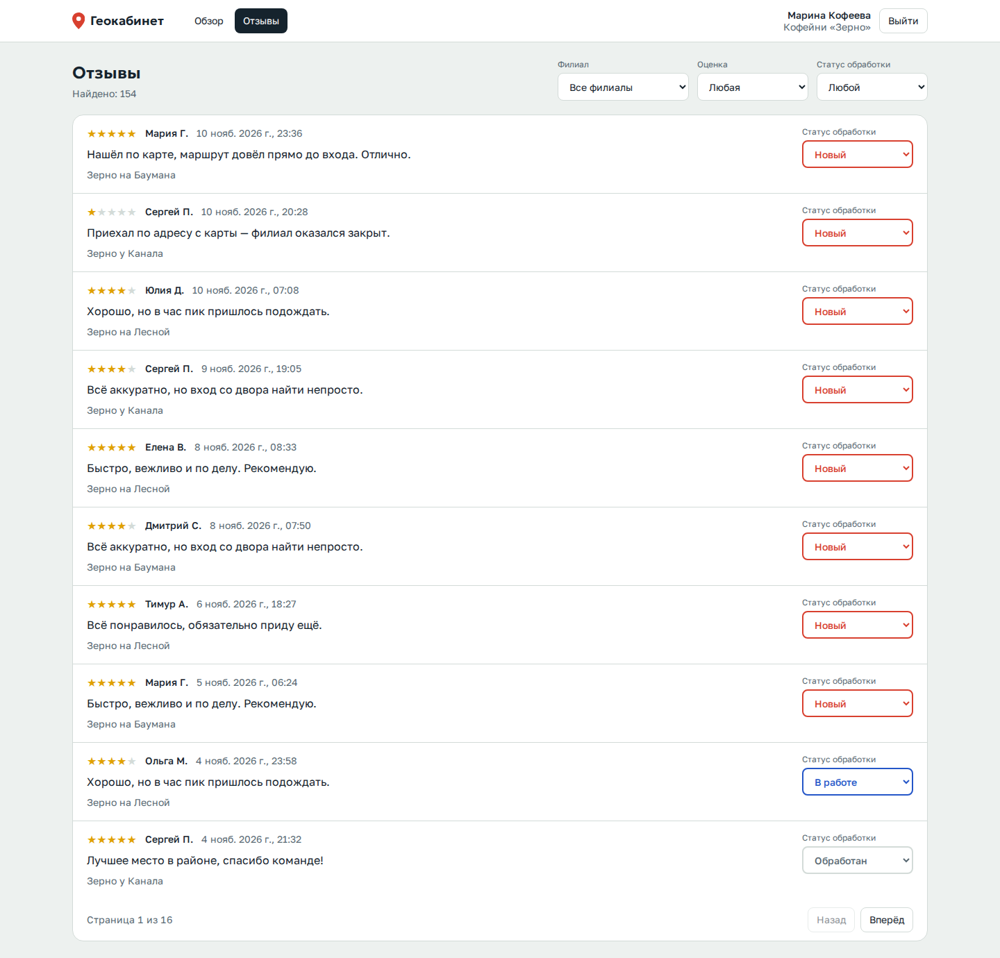

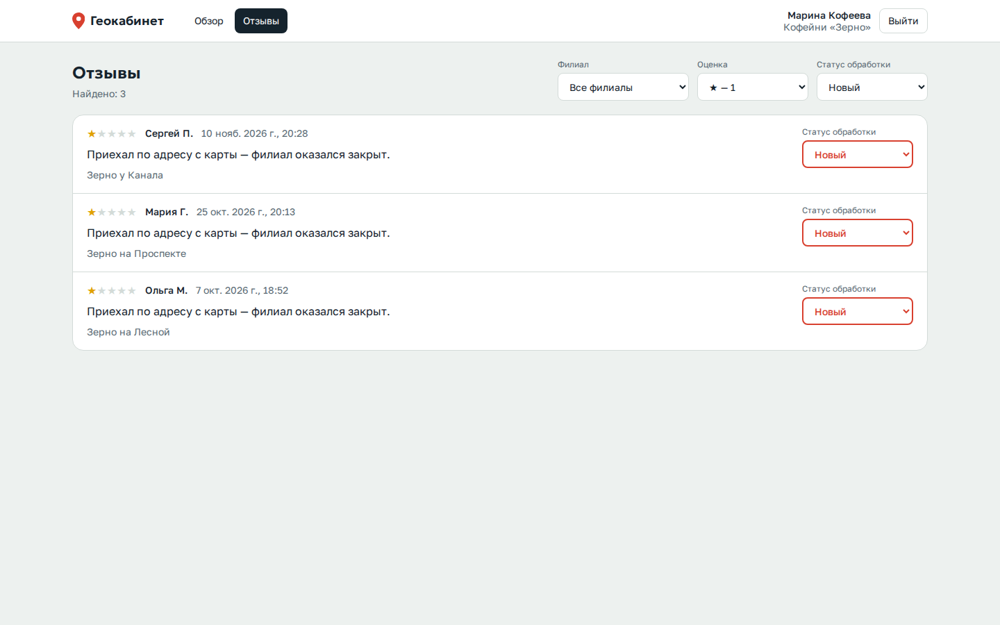

</details>

<details>
<summary>Синхронизация с геосервисом: первый запуск обновил данные, повторный ничего не изменил</summary>

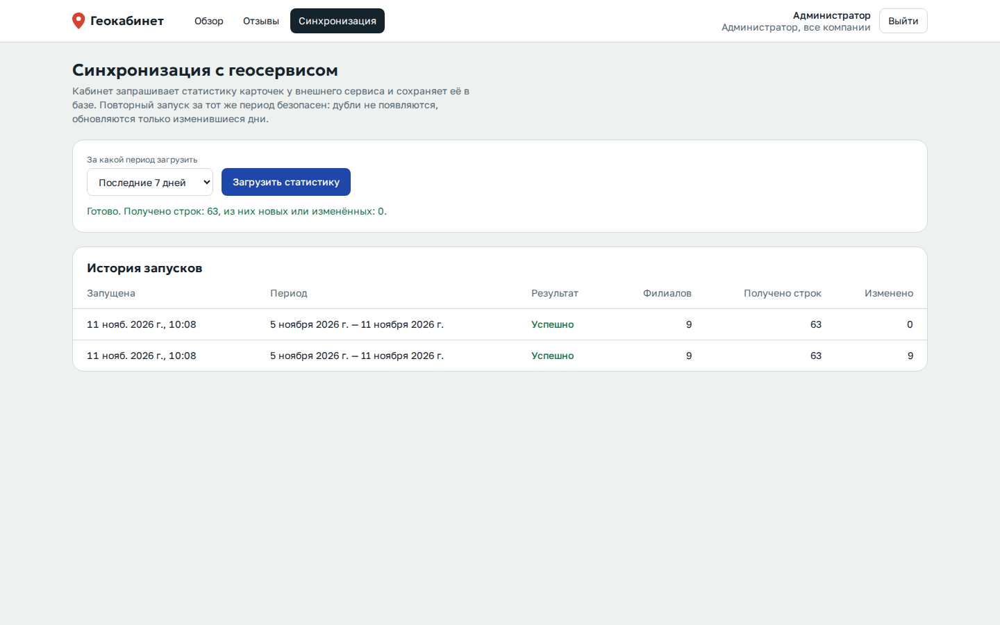

</details>

<details>
<summary>Ошибка загрузки и телефон</summary>

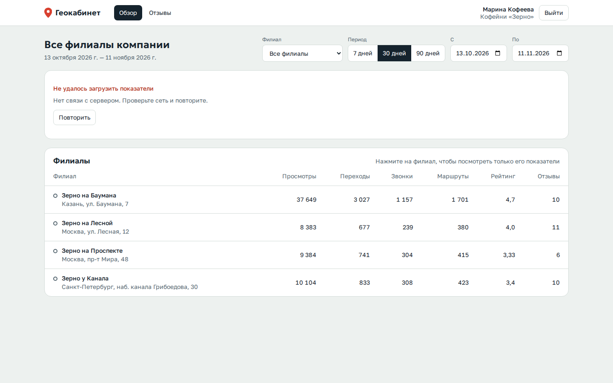

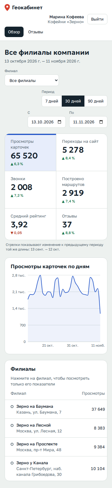

</details>

## Архитектура

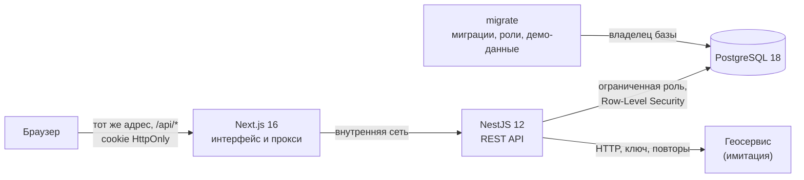

Четыре контейнера: база, разовая подготовка базы, API, интерфейс.

**Почему этот стек.** Он совпадает с предпочтительным из задания, и для такой задачи это разумный выбор: один язык и общие типы с обеих сторон, NestJS даёт модульную структуру и точки для проверки прав, PostgreSQL умеет Row-Level Security и хорошо считает агрегаты по датам. Взяты текущие стабильные версии: Next.js 16, React 19, NestJS 12 (ESM), TypeORM 1.1, PostgreSQL 18, TypeScript 6, Node.js 24 LTS.

**Интерфейс** (`apps/web`) — Next.js App Router, TanStack Query для загрузки и кэша, Recharts для графика, Tailwind CSS. Фильтры хранятся в адресной строке: ссылку с выбранным филиалом и периодом можно переслать, «назад» в браузере возвращает прежний срез.

**Прокси.** Браузер обращается только к своему адресу, а обработчик `apps/web/src/app/api/[...path]/route.ts` передаёт запрос в API. Благодаря этому cookie сессии остаётся `HttpOnly` и `SameSite=Lax`, CORS не нужен, а адрес API читается из окружения при запуске — один и тот же образ работает в любом окружении.

**API** (`apps/api`) — модули `auth`, `branches`, `analytics`, `reviews`, `sync`, `mock-geo`. Входные данные проверяются схемами Zod прямо в декораторах параметров; из этих же схем строится описание OpenAPI.

### Изоляция данных

Защита стоит в двух независимых местах. Первый слой закрывает доступ сам по себе; второй страхует от ошибок в первом — забытого условия или забытого контекста.

1. **API.** Роль и компания пользователя берутся из базы на каждом запросе, а не из токена и не из параметров. Фильтры из запроса превращаются в границы выборки в одной функции — `resolveScope` (`apps/api/src/auth/scope.ts`): клиенту компания подставляется из его учётной записи, чужая компания в фильтре даёт 403, чужой или несуществующий филиал — 404, чтобы по ответу нельзя было узнать, что он есть.
2. **PostgreSQL.** Приложение подключается ролью, которая не владеет таблицами и не может обойти политики Row-Level Security. Каждый запрос идёт в транзакции, где задан контекст пользователя (`apps/api/src/db/tenant-db.ts`). Запрос без единого `WHERE` вернёт только строки своей компании, а запрос, для которого контекст забыли задать, не вернёт ничего. Ошибка программиста в новом маршруте приводит к пустому ответу, а не к утечке.

Миграции выполняет отдельная роль-владелец; у самого приложения прав на изменение схемы нет. От SQL-инъекции второй слой не защищает: контекст задаёт та же роль, что выполняет запросы. Поэтому все значения в запросах передаются параметрами, а имена столбцов берутся из фиксированного списка.

<details>
<summary>Чем это доказано</summary>

Тесты в `apps/api/test/isolation.e2e-spec.ts` идут через настоящий HTTP и настоящий PostgreSQL:

- клиент не видит чужих компаний, филиалов, цифр и отзывов ни в одном списке и ни в одной сумме;
- чужая компания в любом фильтре — 403, чужой филиал — 404, чужой отзыв нельзя изменить, и в базе он остаётся прежним;
- под ролью приложения запрос без условий возвращает только свои строки, чужую строку нельзя ни изменить, ни вставить;
- без контекста пользователя таблицы пусты; контекст не переходит в следующий запрос того же соединения;
- по системному каталогу проверяется, что каждая таблица с `company_id` закрыта политикой, а роль приложения не суперпользователь и не владелец.

В браузерных сценариях клиент дополнительно отправляет прямые запросы с идентификатором чужой компании и получает 403.

</details>

### Модель данных

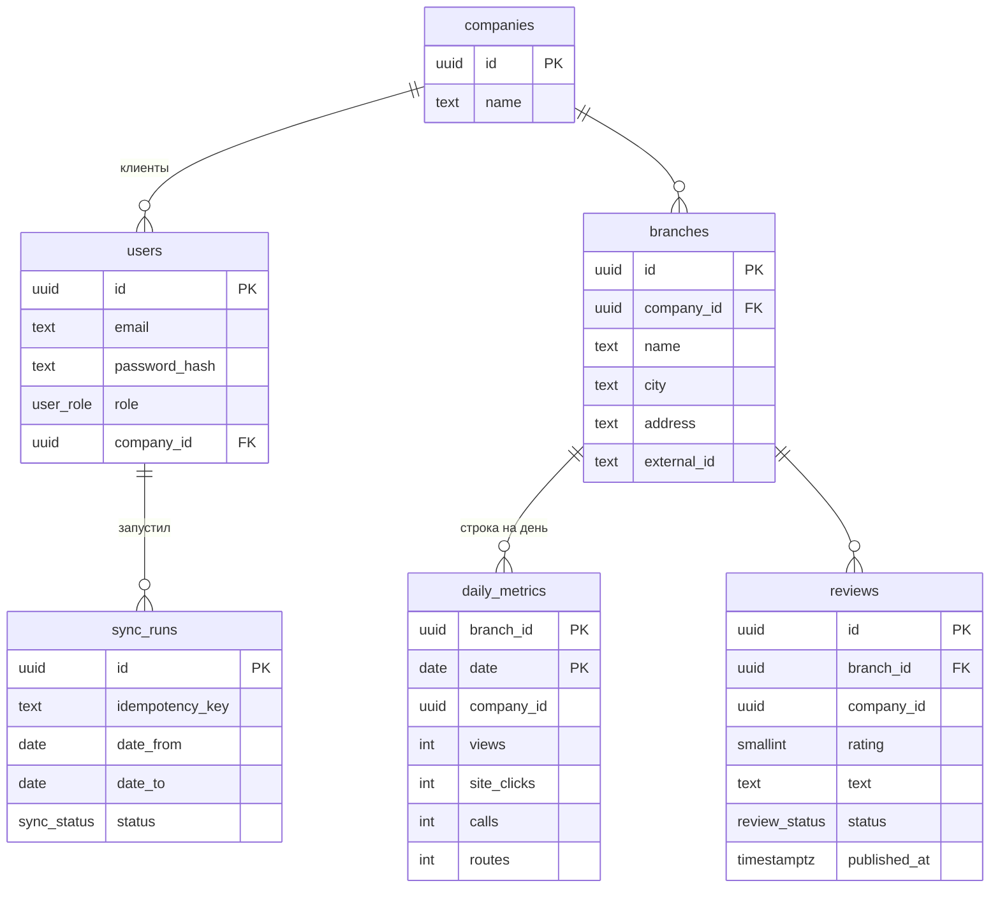

- В `daily_metrics` ключ — пара (филиал, дата): дубль за день невозможен на уровне базы, а повторная загрузка превращается в обновление.
- `company_id` продублирован в показателях и отзывах: по нему работают политики и индексы периода. Составной внешний ключ не даёт ему разойтись с компанией филиала.
- Ограничения в базе: рейтинг от 1 до 5, счётчики неотрицательные, у клиента компания обязательна, у администратора её нет.
- Средний рейтинг и число отзывов считаются по отзывам, опубликованным в выбранном периоде.

### Синхронизация с внешним API

Имитация геосервиса (`apps/api/src/mock-geo`) отвечает по HTTP, требует ключ и в демо-режиме каждый четвёртый запрос отдаёт 503. Кабинет обращается к ней по адресу из `GEO_API_URL` так же, как обращался бы к настоящему сервису.

Повторные запросы безопасны на трёх уровнях:

1. **Ключ идемпотентности.** Интерфейс создаёт `Idempotency-Key` на каждое нажатие. Если ответ потерялся и запрос ушёл повторно, сервер вернёт уже записанный результат. Тот же ключ с другим периодом — 409.
2. **Один запуск одновременно.** Гарантирует частичный уникальный индекс в базе, поэтому условие выполняется и при нескольких экземплярах API. Запуск, оборванный падением процесса, через 15 минут перестаёт блокировать следующий.
3. **Запись через upsert** по (филиал, дата). Повторная загрузка не создаёт дублей и не переписывает строки, которые не изменились; в ответе видно, сколько строк получено и сколько действительно изменилось.

Сбои источника: таймаут 5 секунд, до четырёх попыток с растущей паузой при сетевых ошибках, 5xx и 429. Отказ в доступе и ответ не по формату не повторяются. Ответ проверяется схемой до записи в базу, дни вне запрошенного периода отбрасываются. Сбой по одному филиалу не откатывает остальные, запуск помечается частичным.

## REST API

| Метод и путь | Назначение | Кому |
|---|---|---|
| `POST /api/auth/login` | Вход; cookie и токен в ответе | всем |
| `POST /api/auth/logout` | Выход | всем |
| `GET /api/auth/me` | Текущий пользователь | вошедшим |
| `GET /api/companies` | Компании, доступные пользователю | вошедшим |
| `GET /api/branches` | Филиалы; `companyId`, `page`, `limit` | вошедшим |
| `GET /api/analytics/summary` | Шесть показателей за период и за предыдущий такой же | вошедшим |
| `GET /api/analytics/timeseries` | Показатель по дням; `metric` | вошедшим |
| `GET /api/analytics/branches` | Показатели по каждому филиалу, постранично | вошедшим |
| `GET /api/reviews` | Отзывы; `rating`, `status`, `branchId`, `page`, `limit` | вошедшим |
| `PATCH /api/reviews/:id` | Смена статуса обработки | вошедшим |
| `POST /api/sync/metrics` | Загрузка статистики из геосервиса | администратору |
| `GET /api/sync/runs` | История запусков | администратору |
| `GET /api/health` | Проверка связи с базой | всем |

У аналитических запросов общие параметры `from`, `to` (обязательные, период не длиннее 366 дней), `companyId`, `branchId`. Полное описание — на `/api/docs`.

## Тесты

```bash
cd apps/api
npm ci
npm test
```

Нужен запущенный Docker: тесты сами поднимают чистый PostgreSQL 18 в контейнере, применяют миграции и ходят в API по HTTP. Моков базы нет.

| Файл | Что проверяет |
|---|---|
| `test/isolation.e2e-spec.ts` | Изоляция компаний в API и в базе |
| `test/auth.e2e-spec.ts` | Вход, cookie и токен, подделанный и просроченный токен, одинаковый ответ на неверный пароль и неизвестную почту, ограничение частоты попыток, отказ читать тела не в JSON |
| `test/analytics.e2e-spec.ts` | Суммы, сравнение с прошлым периодом, дни без данных, часовой пояс отзывов, постраничность, отказ на некорректные параметры |
| `test/reviews.e2e-spec.ts` | Фильтры по рейтингу и статусу, смена статуса |
| `test/sync.e2e-spec.ts` | Загрузка, повтор без дублей, ключ идемпотентности, сбои и обрывы источника, ответ не по формату, лишние и повторяющиеся дни, параллельный и зависший запуск |
| `src/**/*.spec.ts` | Расчёт периодов, генератор демо-статистики |

Сценарии в браузере идут против запущенного проекта:

```bash
docker compose up --build -d --wait
cd apps/web
npm ci
npx playwright install chromium
npm run test:e2e
```

Они проходят вход под обеими ролями, фильтры и ввод дат, смену статуса отзыва, синхронизацию, вид на телефоне, сбой загрузки с повтором, некорректную ссылку и истёкшую сессию.

В GitHub Actions (`.github/workflows/ci.yml`) на каждый коммит выполняются линтеры, проверка типов, тесты API, сборка, а затем проект поднимается с нуля через `docker compose` и проходят браузерные сценарии.

<details>
<summary>Запуск без контейнеров приложения (для разработки)</summary>

Нужны Node.js 24 и Docker для базы.

```bash
# база на localhost:5433
docker compose -f docker-compose.yml -f docker-compose.dev.yml up -d db

# API на http://localhost:4000
cd apps/api
cp .env.example .env
npm ci
npm run build
npm run db:migrate
npm run start:dev

# интерфейс на http://localhost:3000 (в другом терминале)
cd apps/web
npm ci
npm run dev
```

</details>

<details>
<summary>Переменные окружения</summary>

Все необязательны, значения по умолчанию рассчитаны на локальную проверку.

| Переменная | По умолчанию | Назначение |
|---|---|---|
| `WEB_PORT`, `API_PORT` | `3000`, `4000` | Порты на вашей машине |
| `DB_OWNER_PASSWORD`, `DB_APP_PASSWORD` | демо-значения | Пароли владельца базы и роли приложения |
| `JWT_SECRET` | случайный при каждом старте | Подпись сессий, не короче 32 символов. Задайте, чтобы вход переживал перезапуск API и работал на нескольких экземплярах |
| `COOKIE_SECURE` | `false` | `true` при работе по HTTPS |
| `REPORT_TIMEZONE` | `Europe/Moscow` | Пояс, по которому отзывы раскладываются по дням |
| `SEED_DEMO` | `true` | Загружать демо-данные в пустую базу |
| `GEO_API_URL`, `GEO_API_KEY` | встроенная имитация | Адрес и ключ геосервиса |
| `MOCK_GEO_FAIL_EVERY` | `4` | Каждый N-й запрос к имитации отвечает 503; `0` — без сбоев |

</details>

<details>
<summary>Структура репозитория</summary>

```text
apps/
  api/                    NestJS
    src/
      auth/               вход, проверка сессии и ролей, границы выборки
      analytics/          сводка, динамика, разбивка по филиалам
      branches/           компании и филиалы
      reviews/            отзывы и статусы обработки
      sync/               клиент геосервиса и синхронизация
      mock-geo/           имитация геосервиса и генератор статистики
      db/                 сущности, миграции, роли, демо-данные
      shared/             периоды, общие схемы параметров
    test/                 тесты API на настоящем PostgreSQL
  web/                    Next.js
    src/app/              страницы, прокси к API
    src/components/       показатели, график, таблица, фильтры
    src/lib/              клиент API, форматирование, фильтры в адресе
    e2e/                  сценарии в браузере
docs/screenshots/         снимки экранов
docker-compose.yml        запуск одной командой
```

</details>

## Известные ограничения

- Сессия: один токен на 8 часов в cookie, без обновления и без отзыва отдельной сессии. Права при этом читаются из базы на каждом запросе, поэтому смена роли или удаление пользователя действуют сразу.
- Ограничение попыток входа считается в памяти процесса и только по учётной записи. Оно не мешает перебирать один пароль по многим адресам, а посторонний может на минуту закрыть вход чужой учётной записи частыми попытками. Для боевого развёртывания нужен второй счётчик по IP за доверенным прокси и общее хранилище счётчиков (Redis).
- Синхронизация выполняется внутри запроса и только по кнопке. Для девяти филиалов это секунды, для тысяч нужна очередь и расписание (см. ниже).
- Часовой пояс отчёта один на всю систему: для сети с филиалами в разных поясах его нужно хранить у компании или филиала.
- Рейтинг и число отзывов считаются по отзывам за выбранный период. Накопленный рейтинг карточки, который показывает сам геосервис, не хранится.
- Управления справочниками нет: компании, филиалы и пользователи создаются миграцией с демо-данными. Регистрации и восстановления пароля нет.
- Отзывы не синхронизируются с внешним источником, они приходят из демо-данных. Имитация отдаёт только статистику.
- Список компаний у администратора отдаётся целиком, а филиал в фильтре выбирается из первых 200 филиалов компании. Для 500 компаний этого хватает, дальше нужен поиск по названию.
- Имитация геосервиса работает в том же процессе, что и API. Обращение идёт по HTTP, поэтому вынести её или заменить настоящим сервисом можно сменой `GEO_API_URL`.
- Пароли базы по умолчанию в `docker-compose.yml`, подсказка с доступами на странице входа и открытое без входа описание API (`/api/docs`) уместны только для проверки тестового. Для развёртывания пароли задаются в `.env`, а имитацию геосервиса и описание API нужно отключить.
- Заголовка Content-Security-Policy у интерфейса нет; встраивание во фрейм и подмена типа содержимого запрещены заголовками.
- Интерфейс только на русском и только в светлой теме.

## Масштабирование до 500+ компаний и нескольких тысяч филиалов

Сначала замер, потом планы. В репозитории есть скрипт, который загружает в базу целевой объём: 500 компаний, 3000 филиалов, год ежедневной статистики (1,1 млн строк) и 120 тысяч отзывов.

```bash
docker compose run --rm migrate node dist/db/seed-scale.js
```

Время ответа API на этом объёме (один контейнер PostgreSQL без настройки, запросы идут через все проверки прав и Row-Level Security; виртуальная машина, 16 ядер, медиана из пяти запросов):

| Запрос | Время |
|---|---|
| Сводка, одна компания, 30 дней | 15 мс |
| Сводка, одна компания, год | 18 мс |
| Динамика, одна компания, год | 20 мс |
| Филиалы компании с показателями | 18 мс |
| Отзывы компании, фильтр по оценке и статусу | 17 мс |
| Сводка, все 503 компании, 30 дней (администратор) | 111 мс |
| Сводка, все компании, год | 174 мс |
| Динамика, все компании, 30 дней | 50 мс |
| Динамика, все компании, год | 412 мс |
| Филиалы всех компаний, страница 200 из 301 | 29 мс |
| Отзывы всех компаний, первая страница | 71 мс |

Вывод: клиентские запросы на целевом масштабе укладываются в десятки миллисекунд без изменений в коде. Год статистики на 3000 филиалов — около 200 МБ вместе с индексами, для PostgreSQL это небольшой объём.

**Что для этого уже заложено**

- Составной ключ (филиал, дата) и индексы (компания, дата) и (дата): запрос клиента читает только строки своей компании за период.
- Все суммы и ряды считает база одним запросом; число запросов не зависит от числа филиалов.
- Таблица филиалов сначала выбирает страницу, затем считает показатели только для неё: десятая страница стоит столько же, сколько первая.
- Списки отдаются постранично, период ограничен 366 днями, размер страницы — 200 строками.
- Контекст Row-Level Security задаётся на транзакцию, поэтому перед базой можно поставить PgBouncer в режиме пула транзакций.
- Идентификаторы — UUIDv7: растут по времени и не дробят индексы при вставке.
- API не хранит состояние между запросами, кроме счётчика попыток входа; экземпляры можно добавлять за балансировщиком.

**Что менять по мере роста и в каком порядке**

1. **Синхронизацию — в очередь.** Сейчас это первое, что упрётся в предел. Нужны задания по филиалам в очереди (BullMQ на Redis или pg-boss на той же базе), несколько обработчиков, ограничение частоты под квоты геосервиса, расписание вместо кнопки. Запись уже идемпотентна, поэтому повтор задания после сбоя ничего не испортит.
2. **Сводные таблицы для запросов по всем компаниям.** Медленнее всего сейчас запросы администратора без фильтра: они читают строки всех филиалов. Решение — таблица дневных итогов по компании, которую синхронизация обновляет в той же транзакции. Запрос администратора за год станет читать 365 × 500 строк вместо миллиона.
3. **Кэш сводок.** Данные меняются только после синхронизации, поэтому ответы сводки и графика можно держать в Redis с ключом (компания, филиал, период) и сбрасывать по завершении загрузки компании.
4. **Реплика для чтения.** Аналитика — это чтение. Аналитические запросы уходят на реплику, запись синхронизации остаётся на основном сервере.
5. **Секционирование `daily_metrics` по месяцам** — когда строк станут сотни миллионов (десятки тысяч филиалов или несколько лет истории). Старые секции можно сжимать и переносить, удаление истории превращается в удаление секции.
6. **Счётчик попыток входа и отзыв сессий — в Redis**, как только экземпляров API становится больше одного.
7. **Наблюдаемость:** длительность запросов по маршрутам, медленные запросы базы, доля неуспешных синхронизаций по компаниям, оповещение, если данные компании не обновлялись дольше суток.
8. **Интерфейс:** поиск по названию в выборе компании и филиала вместо полного списка, выгрузка таблицы филиалов в файл.

Отдельная база или схема на каждую компанию для такого размера не нужна: общие таблицы с `company_id` и Row-Level Security проще в миграциях и обслуживании, а изоляцию обеспечивает сама база.
